# Onde os dados do Senado não batem entre si

O Senado Federal publica, na internet, quanto cada senador usa da verba do mandato e quantas pessoas trabalham no gabinete. Ao reunir esses dados, o Senadados encontrou lugares em que **duas publicações oficiais do próprio Senado mostram números diferentes para a mesma coisa**.

Este documento mostra cada caso com **imagens (prints) das telas e dos arquivos do Senado**, para que qualquer pessoa confira sozinha. Tudo foi capturado em **18/11/2026, entre 16h49 e 16h53** (horário de Brasília).

## Por que isso importa

Quando o Senado mostra dois números para a mesma coisa, quem lê não tem como saber qual dos dois vale. Um jornalista, um pesquisador ou um cidadão que copiar o número da tela pode estar copiando um valor diferente do que está no arquivo de dados abertos, e o contrário também.

Por isso o Senadados só mostra um número quando **as publicações do Senado concordam entre si**. Os casos abaixo são os que não passaram nesse teste.

## O que este documento não afirma

- **Não afirma qual dos números está certo.** Só mostra que eles são diferentes.
- **Não afirma o motivo.** Pode ser uma data de atualização diferente, um critério de contagem diferente ou outra causa. Não sabemos.
- **Não afirma que alguém fez algo errado.** Os senadores aparecem porque o Senado publica os dados por senador, e é nessa publicação que a diferença está.
- **Só entra aqui o que tem print.** O que encontramos e não conseguimos mostrar numa imagem fica de fora. As contagens que cobrem todos os gabinetes ou todos os senadores (por exemplo, “em 80 dos 81”) foram feitas pelo Senadados e podem ser refeitas com o código do projeto; os prints mostram um caso de cada.

## Como conferir

Cada caso traz o endereço da tela ou do arquivo e o passo a passo. A tela de cada senador fica em `www6g.senado.leg.br/transparencia/sen/` seguido do código do senador, e os arquivos de despesas ficam em `senado.leg.br/transparencia/LAI/verba/`. Os números podem mudar se o Senado atualizar os dados depois da data dos prints.

---

## 1. A tela diz 27 pessoas; a exportação da mesma tela diz 28

**Onde:** página “Recursos Utilizados em 2026” do senador Camilo Santana, bloco “Pessoal”, e o botão “Exportar HTML” da mesma página.

**Na tela** do portal, o gabinete tem **27 pessoas**, todas comissionadas:

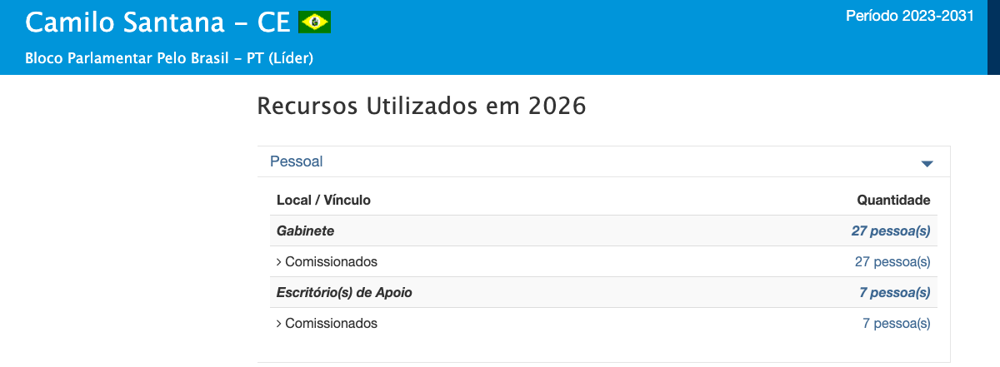

**Na exportação da mesma página** (o botão “Exportar HTML”), gerada às 16h49, o gabinete tem **28 pessoas**: 27 comissionadas e **1 efetiva**:

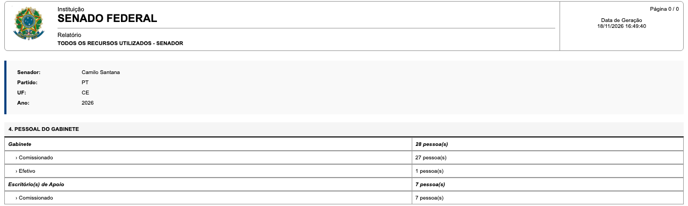

**O argumento:** o Senado tem 81 gabinetes de senadores em exercício. Comparamos a tela com a exportação nos 81, nos três tipos de vínculo que as duas publicam (comissionado, efetivo e requisitado). **Em 80 gabinetes elas concordam. Neste, não:** a tela não mostra nenhum efetivo, e a exportação mostra um.

**Como conferir:** abra `www6g.senado.leg.br/transparencia/sen/6336/?ano=2026`, role até “Pessoal” e depois use “Exportar → HTML” na parte de cima da página.

---

## 2. “Gabinete: 22 pessoas” ou “Gabinete: 17 pessoas”?

**Onde:** página “Recursos Utilizados em 2026” do senador Alan Rick, bloco “Pessoal”, e a exportação da mesma página.

A **tela** mostra **22 pessoas** no gabinete. Elas são 14 comissionadas, 3 efetivas, **1 estagiária e 4 terceirizadas**:

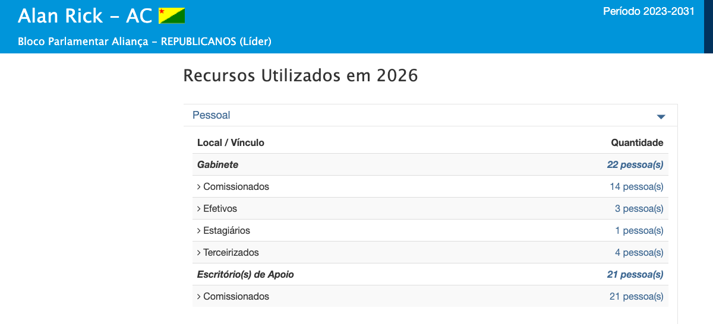

A **exportação** da mesma página mostra **17 pessoas**, sem estagiários nem terceirizados:

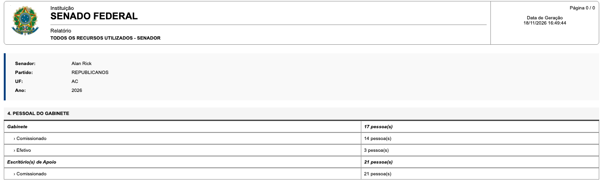

**O argumento:** as duas publicações usam o mesmo rótulo, “Gabinete”, para totais diferentes, e a exportação não traz nenhuma nota dizendo que deixa de fora estagiários e terceirizados. Quem compara os dois sem notar a diferença de critério acha que um deles está errado. Na linha “Gabinete”, **o total da tela e o da exportação são diferentes em 79 dos 81 gabinetes**. Em 78 gabinetes a tela mostra terceirizados, e em 4 mostra estagiários.

**Como conferir:** abra `www6g.senado.leg.br/transparencia/sen/5672/?ano=2026`, veja o bloco “Pessoal”, e compare com “Exportar → HTML”.

---

## 3. Cota de 2008 e de 2009: a tela mostra menos do que o arquivo de despesas

**Onde:** página “Recursos Utilizados” de cinco senadores que já tinham despesa em 2008, e o arquivo oficial de despesas da cota de cada ano.

**Em 2008**, a tela mostra **R$ 0,00** de cota para os cinco:

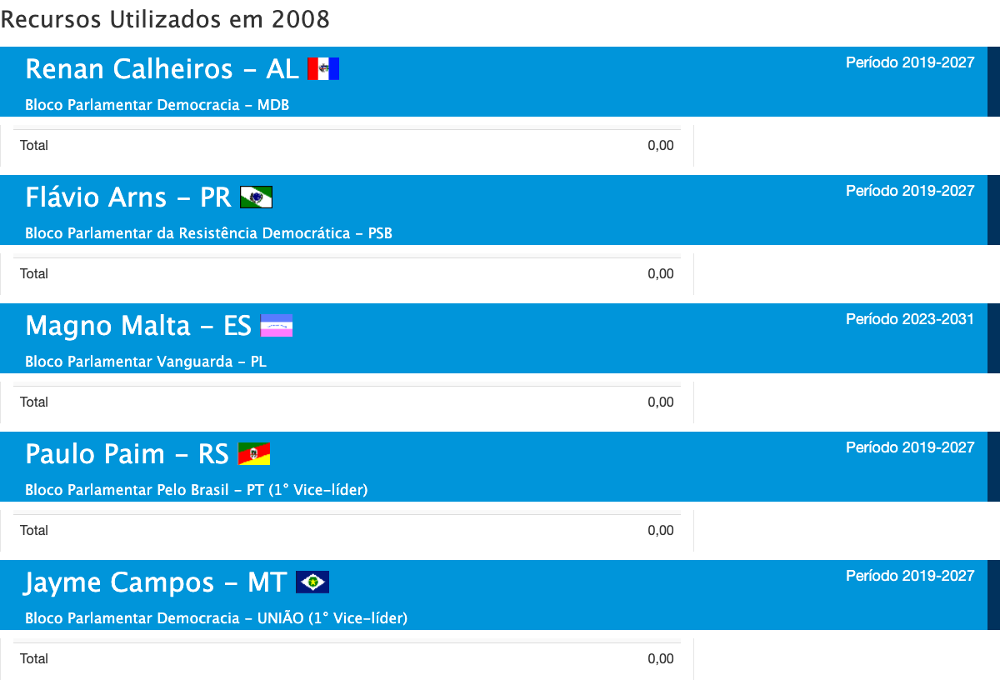

Mas o **arquivo oficial de despesas de 2008** traz notas fiscais reembolsadas para os mesmos cinco:

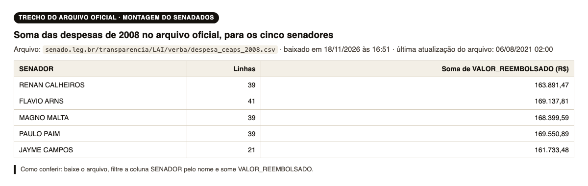

**Em 2009**, a tela mostra um total, mas **menor** que a soma do arquivo:

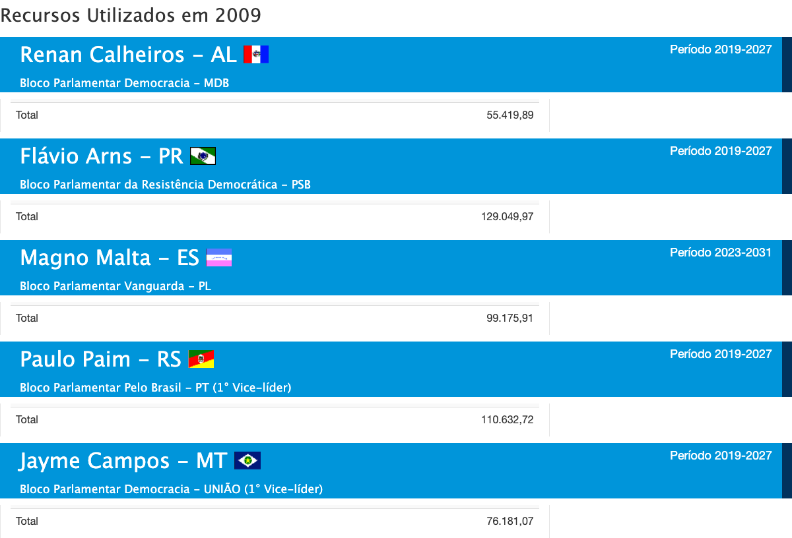

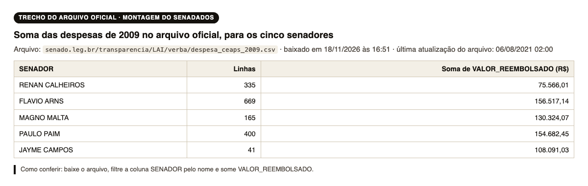

| Senador | Tela, 2008 | Arquivo, 2008 | Tela, 2009 | Arquivo, 2009 | Diferença, 2009 |
|---|---|---|---|---|---|
| Renan Calheiros | R$ 0,00 | R$ 163.891,47 | R$ 55.419,89 | R$ 75.566,01 | R$ 20.146,12 |
| Flávio Arns | R$ 0,00 | R$ 169.137,81 | R$ 129.049,97 | R$ 156.517,14 | R$ 27.467,17 |
| Magno Malta | R$ 0,00 | R$ 168.399,59 | R$ 99.175,91 | R$ 130.324,07 | R$ 31.148,16 |
| Paulo Paim | R$ 0,00 | R$ 169.550,89 | R$ 110.632,72 | R$ 154.682,45 | R$ 44.049,73 |
| Jayme Campos | R$ 0,00 | R$ 161.733,48 | R$ 76.181,07 | R$ 108.091,03 | R$ 31.909,96 |

**O argumento:** para os anos de 2010 em diante, a conferência automática do Senadados não encontrou diferença desse tipo entre o resumo do Senado (a mesma fonte da tela) e o arquivo de despesas, fora as linhas sem categoria do caso seguinte. Em 2008 e 2009, nos cinco senadores em exercício que já tinham despesa, a conta não fecha. Em 2008 a diferença é total: a tela diz que não houve nada, e o arquivo diz que houve mais de R$ 160 mil por senador.

**Um detalhe:** o arquivo de 2008 e o de 2009 informam, na primeira linha, que foram atualizados pela última vez em **06/08/2021**. É possível que a diferença venha daí, mas isso **não está confirmado**.

**Como conferir:** abra `www6g.senado.leg.br/transparencia/sen/345/?ano=2009` (troque o código para ver os outros: 70, 631, 825 e 4531) e compare o “Total” da cota com a soma da coluna `VALOR_REEMBOLSADO` do arquivo `despesa_ceaps_2009.csv`, filtrando o senador.

---

## 4. Linhas de despesa sem categoria que a tela não conta

**Onde:** página “Recursos Utilizados em 2026” do senador Hamilton Mourão, bloco “Cotas”, e o arquivo oficial de despesas de 2026.

A **tela** mostra um total de cota de **R$ 445.712,33**, somando as sete categorias:

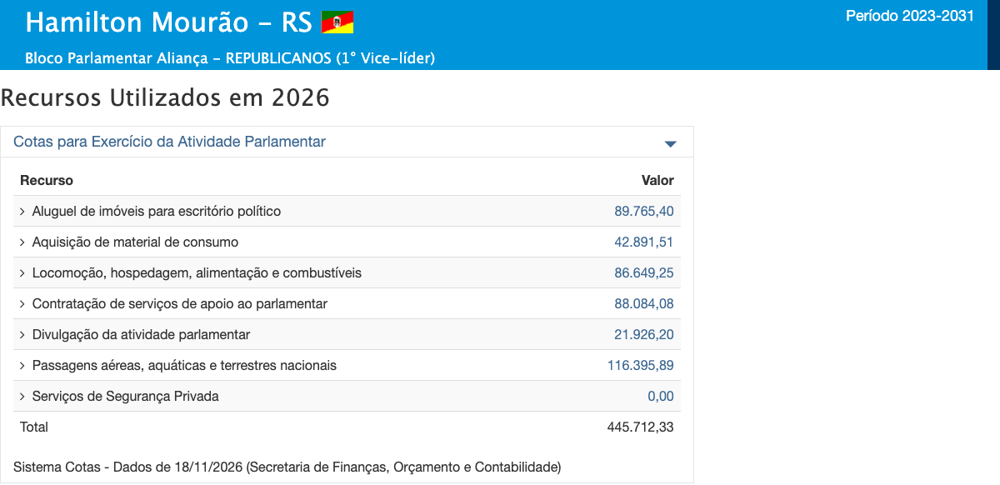

O **arquivo oficial de 2026** soma **R$ 480.712,33** para o mesmo senador. A diferença, de **R$ 35.000,00**, é exatamente a soma de **10 linhas em que a categoria da despesa está em branco**:

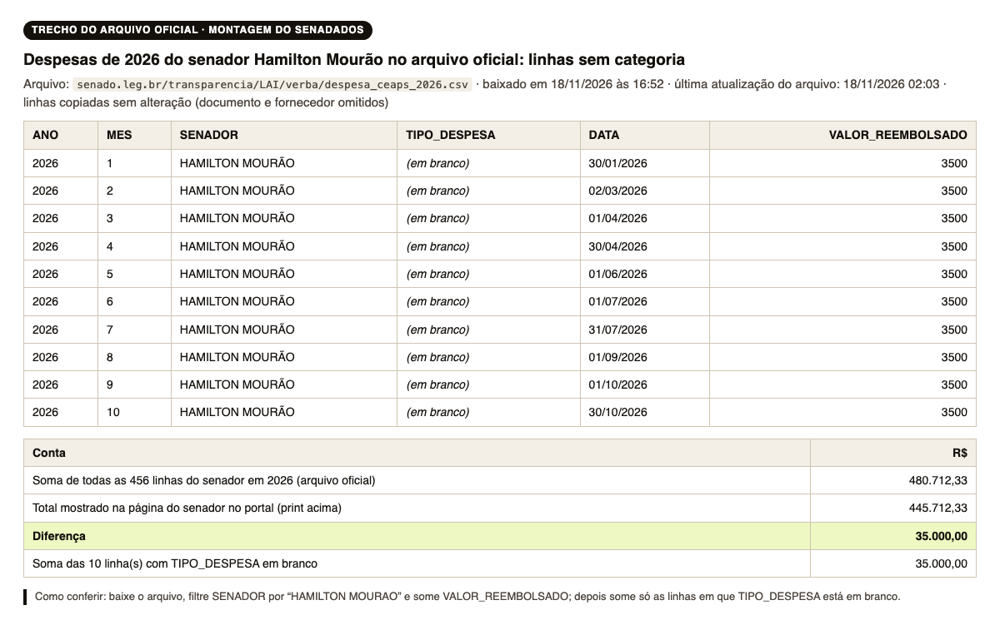

**O argumento:** essas linhas existem no arquivo de dados abertos, com valor e data, mas a tela não as conta em nenhuma das sete categorias. Quem soma as sete categorias da tela chega a um número menor do que quem soma o arquivo. Aqui, a diferença tem uma explicação, e ela está nas linhas sem categoria. Na tela não há nota dizendo que essas linhas ficam de fora.

**Como conferir:** abra `www6g.senado.leg.br/transparencia/sen/6341/?ano=2026`, anote o “Total” e compare com a soma de `VALOR_REEMBOLSADO` do arquivo `despesa_ceaps_2026.csv` para “HAMILTON MOURAO”. Depois some só as linhas com `TIPO_DESPESA` em branco.

---

## 5. Notas com data que não pode existir

**Onde:** arquivo oficial de despesas de 2024.

O arquivo traz notas com data de ano **0204** e **0202**, que não podem ser datas de notas fiscais reembolsadas em 2024:

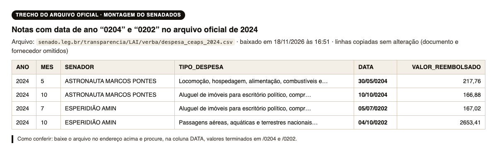

**O argumento:** é provável que seja erro de digitação (por exemplo, 2024 escrito como 0204), mas o arquivo não tem como mostrar isso. Quem filtrar notas por data vai perder essas linhas, ou vai achar que são de séculos atrás.

**Como conferir:** baixe `despesa_ceaps_2024.csv` e procure, na coluna `DATA`, valores terminados em `/0204` e `/0202`.

---

## O que o Senadados faz com cada caso

| Caso | O que aparece no Senadados |
|---|---|
| 1. Gabinete com 27 ou 28 pessoas | O número de pessoas desse gabinete **não aparece**; os outros 80 aparecem |
| 2. Totais diferentes na linha “Gabinete” | O Senadados usa o total da exportação (comissionados, efetivos e requisitados) e **diz o que ele inclui** |
| 3. Cota de 2008 e de 2009 | A cota desses anos, para esses senadores, **não aparece** |
| 4. Linhas sem categoria | As linhas **aparecem**, como “Sem categoria”, com a explicação |
| 5. Datas impossíveis | A despesa **entra na soma**; a data fica de fora e a linha é marcada |

Os critérios completos estão nas decisões [D025](decisoes.md#d025-só-o-comprovado-a-prova-real), [D035](decisoes.md#d035-verificação-automática-da-cota-por-categoria-na-mesma-foto-dos-dados), [D036](decisoes.md#d036-verificação-automática-da-equipe-do-gabinete-por-vínculo) e [D037](decisoes.md#d037-exibição-por-tipo-de-dado-e-freio-de-segurança), e os resultados de cada verificação estão em [verificacoes.md](verificacoes.md).

*As imagens com a etiqueta “trecho do arquivo oficial · montagem do Senadados” são tabelas feitas pelo Senadados a partir de linhas do arquivo oficial, sem alterar nenhum valor. As demais são capturas das telas e dos relatórios do próprio Senado, recortadas para mostrar só o trecho em questão.*
